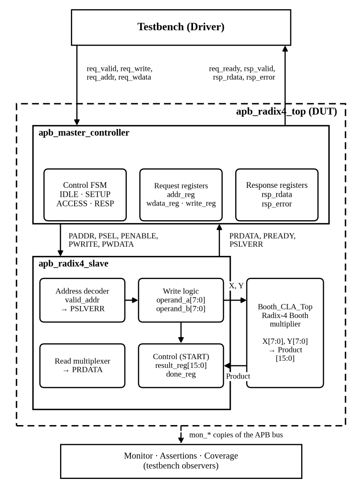
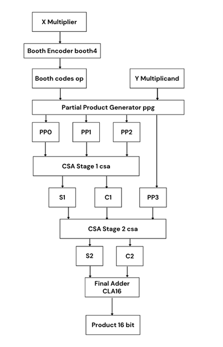
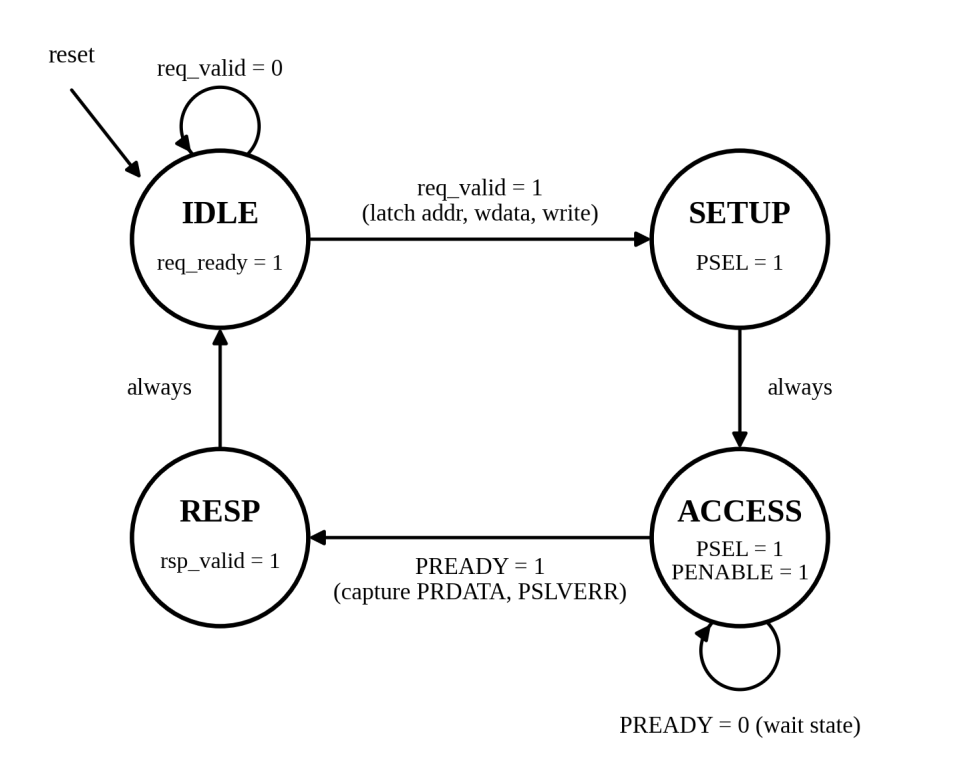
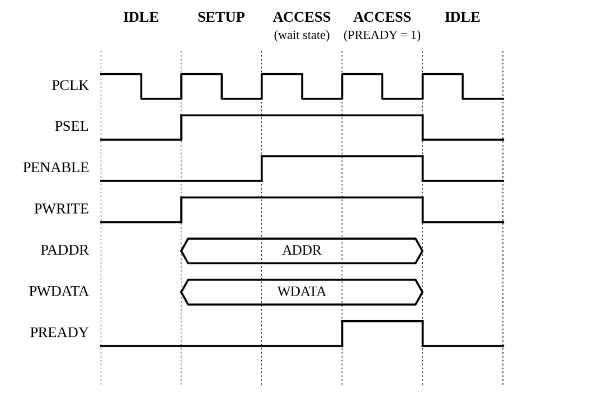
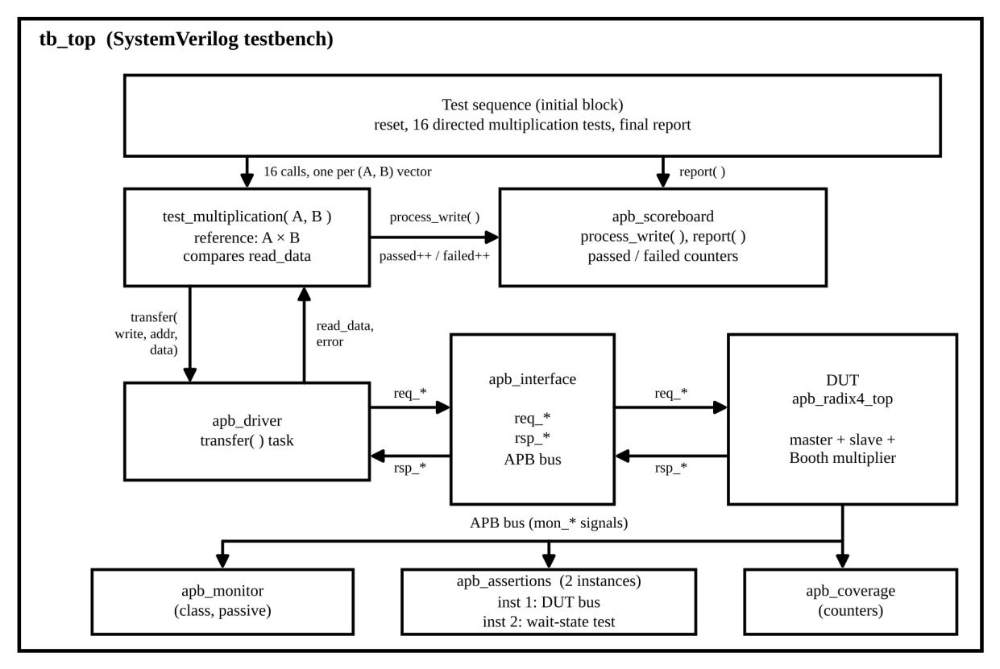
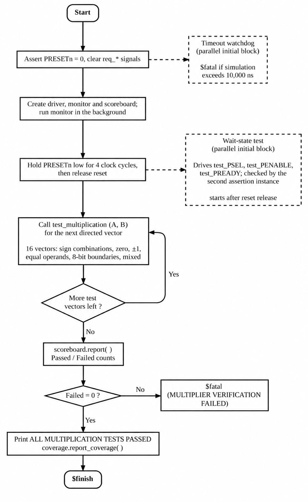
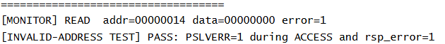
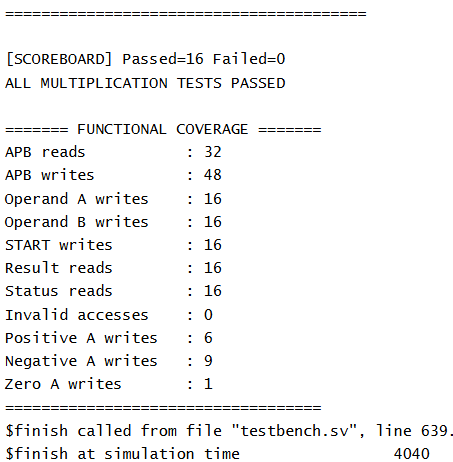
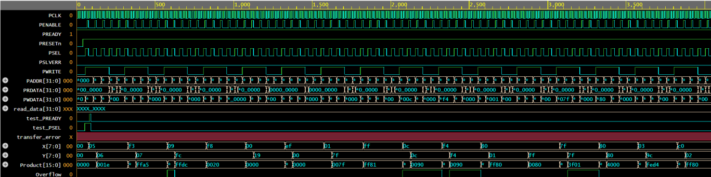

# APB-Compliant Radix-4 Booth Multiplier

A signed 8-bit Radix-4 Booth multiplier integrated as a memory-mapped APB peripheral and verified using a class-based SystemVerilog testbench.

> **Project type:** RTL Design and Functional Verification  
> **HDL:** SystemVerilog  
> **Simulation:** Synopsys VCS X-2025.06-SP1_Full64  
> **Clock:** 100 MHz (10 ns period)

## Overview

This project wraps an existing combinational, signed 8-bit Radix-4 Booth multiplier with an APB master controller and an APB slave containing five memory-mapped registers. Software-like register transactions write the operands, issue a START command, and read back the multiplication result and completion status.

The design is organized into two main parts:

- **Arithmetic datapath:** Radix-4 Booth encoder, partial-product generator, two carry-save adder (CSA) stages, and a 16-bit carry-look-ahead (CLA) final adder.
- **APB peripheral:** Four-state master FSM, register-mapped slave, and top-level integration.

The verification environment is class-based SystemVerilog (not UVM). It includes a virtual-interface-based driver, passive monitor, reference-model scoreboard, protocol assertions, and counter-based functional coverage.

## Architecture



The top-level module, `apb_radix4_top`, connects `apb_master_controller` and `apb_radix4_slave`. The multiplier is continuously driven by the operand registers; writing START captures its current product into the result register.

### Multiplier datapath



For an 8-bit signed multiplication, the encoder examines four overlapping 3-bit groups and recodes the multiplier into digits from −2 to +2. The partial-product generator produces four shifted partial products. Two CSA stages reduce these to two operands, which are added by the 16-bit CLA.

### APB master FSM



The master uses four states:

1. `IDLE` – accepts a request when `req_valid` is asserted.
2. `SETUP` – asserts `PSEL` while keeping `PENABLE` low.
3. `ACCESS` – asserts `PSEL` and `PENABLE`; waits for `PREADY`.
4. `RESP` – presents the captured read data and error response for one cycle.

The APB timing reference is shown below.



## Register map

The peripheral has a 32-bit APB data path. Operand values are signed 8-bit quantities stored in `PWDATA[7:0]`.

| Offset | Register | Access | Description |
|---|---|---|---|
| `0x00` | `OPERAND_A` | Read/Write | Signed 8-bit operand X |
| `0x04` | `OPERAND_B` | Read/Write | Signed 8-bit operand Y |
| `0x08` | `CONTROL` | Write | Bit 0 = START; reads return 0 |
| `0x0C` | `RESULT` | Read only | Signed 16-bit product, sign-extended to 32 bits |
| `0x10` | `STATUS` | Read only | Bit 0 = DONE |

### Programming sequence

1. Write operand X to `OPERAND_A` (`0x00`).
2. Write operand Y to `OPERAND_B` (`0x04`).
3. Write `1` to `CONTROL` (`0x08`) to capture the multiplier output and set DONE.
4. Read `STATUS` (`0x10`) and check bit 0.
5. Read the signed, sign-extended result from `RESULT` (`0x0C`).

**Implementation notes:** `PREADY` is tied high, so the implemented slave completes accesses without wait states. `DONE` remains asserted after START until reset. Writes to the read-only RESULT and STATUS registers are ignored. An unmapped address asserts `PSLVERR` during ACCESS.

## Verification environment



The testbench is built from the following components:

| Component | Type | Responsibility |
|---|---|---|
| `apb_interface` | Interface | Groups APB bus and request/response signals |
| `apb_driver` | Class | Sends requests through the master's request/response handshake |
| `apb_monitor` | Class | Passively observes completed APB transfers |
| `apb_transaction` | Class | Holds request/response transaction fields |
| `apb_scoreboard` | Class | Models operands and checks the sign-extended product |
| `apb_assertions` | Module | Checks APB protocol properties |
| `apb_coverage` | Module | Counts completed reads, writes and selected operand categories |
| `tb_top` | Module | Instantiates the DUT and runs the directed test sequence |

The transaction class declares randomizable request fields (`rand`), but the current test sequence uses predefined directed operands; **randomization is not used to generate stimulus**.

### Checks performed

- 16 directed signed multiplication tests, including positive/negative combinations, zero, ±1, equal operands, and signed 8-bit boundary values.
- Result comparison against an independently calculated signed reference product, including 32-bit sign extension.
- STATUS readback and DONE-bit check.
- APB protocol assertions:
  - ACCESS follows SETUP.
  - Address, direction and write data remain stable during wait states.
  - `PENABLE` is never asserted unless `PSEL` is high.
- A separate two-cycle wait-state assertion test. This uses dedicated test signals because the DUT slave itself has `PREADY` tied high.
- Invalid-address read at `0x14`, checking `PSLVERR` on the APB bus and error propagation through `rsp_error`.

### Testbench execution flow



## Simulation results

### Directed multiplication results

All 16 directed multiplication tests passed in the reported simulation.

| Test case | Operand A | Operand B | Expected result | Status |
|---|---:|---:|---:|---|
| Positive × positive | 5 | 6 | 30 (`0x001E`) | PASS |
| Negative × positive | −13 | 7 | −91 (`0xFFA5`) | PASS |
| Positive × negative | 9 | −4 | −36 (`0xFFDC`) | PASS |
| Negative × negative | −8 | −4 | 32 (`0x0020`) | PASS |
| Zero × positive | 0 | 25 | 0 | PASS |
| Negative × zero | −17 | 0 | 0 | PASS |
| One × positive | 1 | 127 | 127 | PASS |
| Minus one × positive | −1 | 127 | −127 | PASS |
| Equal positive operands | 12 | 12 | 144 (`0x0090`) | PASS |
| Equal negative operands | −12 | −12 | 144 (`0x0090`) | PASS |
| Minimum × one | −128 | 1 | −128 | PASS |
| Minimum × minus one | −128 | −1 | 128 | PASS |
| Maximum × maximum | 127 | 127 | 16129 (`0x3F01`) | PASS |
| Minimum × minimum | −128 | −128 | 16384 (`0x4000`) | PASS |
| Mixed-sign operands | 3 | −100 | −300 (`0xFED4`) | PASS |
| Negative × positive | −64 | 2 | −128 (`0xFF80`) | PASS |

### Scoreboard and functional coverage





The reported multiplication run recorded:

| Coverage item | Count |
|---|---:|
| APB writes | 48 |
| APB reads | 32 |
| Operand A writes | 16 |
| Operand B writes | 16 |
| START writes | 16 |
| RESULT reads | 16 |
| STATUS reads | 16 |
| Invalid accesses in this coverage snapshot | 0 |

The 48 writes and 32 reads correspond to the five APB transactions performed for each of the 16 multiplication tests: two operand writes, one START write, one STATUS read, and one RESULT read.

The invalid-address test is executed separately after the multiplication coverage report and passed: the slave asserted `PSLVERR` for address `0x14`, and the master returned `rsp_error = 1`. Therefore, the zero invalid-access count shown in the multiplication coverage snapshot does not mean the invalid-address test was skipped.

### Simulation waveform



## Repository structure

```text
apb-radix4-booth-multiplier/
├── README.md
├── design/
│   └── rtl/
│       └── design.sv
├── verification/
│   ├── tb/
│   │   └── testbench.sv
│   ├── assertions/
│   │   └── README.md
│   └── results/
│       └── README.md
├── images/
│   ├── apb_timing_diagram.png
│   ├── apb_master_fsm.png
│   ├── apb_multiplier_architecture.png
│   ├── radix4_multiplier_datapath.png
│   ├── verification_environment.png
│   ├── testbench_execution_flow.png
│   ├── simulation_waveform.png
│   ├── scoreboard_console.png
│   └── functional_coverage_console.png
└── docs/
    └── APB_Radix4_Booth_Multiplier_Report.pdf
```

The current RTL contains the APB assertions alongside the design modules, so `verification/assertions/` is reserved for a future clean separation if you decide to move them into a dedicated source file. The same applies to saved simulator logs and waveforms under `verification/results/`.

## Running the simulation

The report identifies Synopsys VCS `X-2025.06-SP1_Full64` as the simulator used.

From the repository root, compile the RTL and testbench:

```bash
vcs -full64 -sverilog \
    design/rtl/design.sv \
    verification/tb/testbench.sv \
    -o simv
```

Run:

```bash
./simv
```

The testbench is configured to generate `dump.vcd`. If your VCS setup uses a different waveform format or requires additional library/runtime options, adapt the invocation to your local installation.

## Current scope and future work

- Current stimulus is directed; constrained-random stimulus generation is not implemented.
- The implemented APB slave is zero-wait-state (`PREADY = 1`). Wait-state behavior is checked with a separate assertion stimulus rather than by inserting wait states into the DUT.
- Functional coverage uses counters for transaction types and the sign of OPERAND_A; it does not provide full cross coverage of all operand-sign combinations.
- Future extensions could add constrained-random operand generation, broader functional coverage, and integrated wait-state stimulus in a configurable APB slave.

## Inference

The project demonstrates the integration of a signed Radix-4 Booth multiplier into an APB memory-mapped peripheral. The arithmetic result is checked using a reference-model scoreboard, while protocol assertions and functional coverage provide additional checks on bus behaviour and exercised transactions.

The 16 directed multiplication tests passed, and the separate invalid-address test confirmed error propagation from `PSLVERR` to `rsp_error`. The class-based testbench separates stimulus, observation, checking, and coverage collection, making the verification process more structured and easier to debug.

## Contributors

- Priyadharshan L
- Saabiq U A
- Krishnashree D

---

*Academic mini project — Design and Verification using SystemVerilog, College of Engineering, Guindy, Anna University.*
